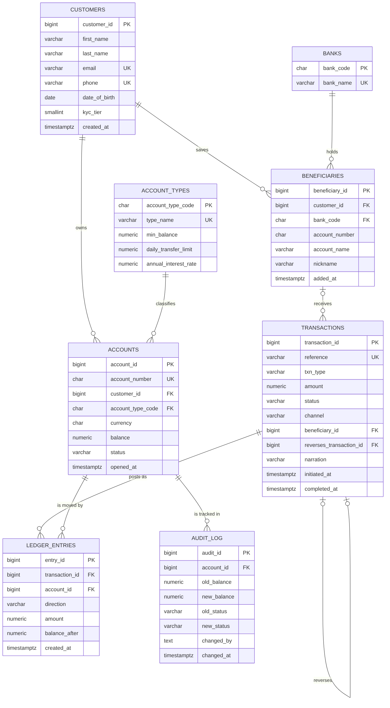

# Portfolio 1: Database Design and Modelling

**Student:** Ajilore Opeyemi (301930319)
**Course:** MIT 8103 Advanced Database Systems
**Case study:** LagoonPay, a simulated Nigerian digital bank
**Engine:** PostgreSQL 16

## 1. Case study

| Item | Description |
|---|---|
| Organisation | LagoonPay, a simulated app-only bank based in Lagos. It is not a real company. |
| Nature of the system | Retail banking without branches. Customers open savings, current and wallet accounts and move money from a mobile app, the web, USSD, POS terminals and ATMs. |
| Users of the database | Customers (through the app), customer support agents (look up accounts, freeze accounts), the operations team (reverse failed or mistaken transfers), compliance and internal audit (reconcile balances, review the audit trail), and reporting jobs. |
| Major data stored | Customers and their KYC tier, account products and their limits, accounts and balances, saved beneficiaries at other banks, transactions, the ledger lines behind each transaction, and an audit log of balance and status changes. |
| Key operations | Open an account, deposit, withdraw, transfer between LagoonPay accounts, transfer to a saved beneficiary at another bank, reverse a transaction, freeze an account, produce a statement, reconcile stored balances against the ledger. |

The same case study is used in Portfolios 2 to 5.

## 2. ER diagram



The source is in [`er-diagram.mmd`](er-diagram.mmd) (Mermaid).

Relationships and cardinalities:

| Relationship | Cardinality | Meaning |
|---|---|---|
| customers to accounts | 1 : N | A customer can hold several accounts; an account has exactly one owner. |
| account_types to accounts | 1 : N | Every account is one product type. |
| customers to beneficiaries | 1 : N | A customer keeps a private list of saved payees. |
| banks to beneficiaries | 1 : N | Each payee is at one bank. |
| beneficiaries to transactions | 0..1 : N | Only external transfers point to a beneficiary. |
| transactions to transactions | 0..1 : 0..1 | A reversal points to the transaction it undoes; a transaction can be reversed once. |
| transactions to ledger_entries | 1 : N | A deposit or withdrawal has one line, an internal transfer has two. |
| accounts to ledger_entries | 1 : N | The account's statement. |
| accounts to audit_log | 1 : N | History of balance and status changes. |

`ledger_entries` resolves the many-to-many relationship between accounts and transactions: one transaction touches several accounts, and one account takes part in many transactions.

## 3. Relational schema

Primary keys are underlined with **bold**, foreign keys are in *italics*.

- account_types(**account_type_code**, type_name, min_balance, daily_transfer_limit, annual_interest_rate)
- banks(**bank_code**, bank_name)
- customers(**customer_id**, first_name, last_name, email, phone, date_of_birth, kyc_tier, created_at)
- accounts(**account_id**, account_number, *customer_id*, *account_type_code*, currency, balance, status, opened_at)
- beneficiaries(**beneficiary_id**, *customer_id*, *bank_code*, account_number, account_name, nickname, added_at)
- transactions(**transaction_id**, reference, txn_type, amount, status, channel, *beneficiary_id*, *reverses_transaction_id*, narration, initiated_at, completed_at)
- ledger_entries(**entry_id**, *transaction_id*, *account_id*, direction, amount, balance_after, created_at)
- audit_log(**audit_id**, *account_id*, old_balance, new_balance, old_status, new_status, changed_by, changed_at)

The full DDL is in [`01_schema.sql`](01_schema.sql).

## 4. Keys

| Table | Primary key | Candidate / alternate keys | Foreign keys |
|---|---|---|---|
| account_types | account_type_code | type_name | none |
| banks | bank_code | bank_name | none |
| customers | customer_id (surrogate) | email; phone | none |
| accounts | account_id (surrogate) | account_number | customer_id, account_type_code |
| beneficiaries | beneficiary_id (surrogate) | (customer_id, bank_code, account_number) | customer_id, bank_code |
| transactions | transaction_id (surrogate) | reference | beneficiary_id, reverses_transaction_id |
| ledger_entries | entry_id (surrogate) | (transaction_id, account_id, direction) | transaction_id, account_id |
| audit_log | audit_id (surrogate) | none | account_id |

Why surrogate keys: natural keys such as email, phone and account number are either changeable or sensitive. A `BIGINT` identity key stays stable, keeps foreign keys narrow, and keeps customer-identifying values out of child tables. The natural keys are still enforced with `UNIQUE`.

## 5. Constraints

| Type | Example in this schema | Rule it protects |
|---|---|---|
| Entity integrity | `PRIMARY KEY` on every table | Every row is identifiable. |
| Referential integrity | `accounts.customer_id REFERENCES customers ON DELETE RESTRICT` | No orphan accounts; a customer who holds accounts cannot be deleted. |
| Referential action | `beneficiaries.customer_id ... ON DELETE CASCADE` | A payee list has no meaning without its owner. |
| Uniqueness | `UNIQUE (customer_id, bank_code, account_number)` | The same payee cannot be saved twice. |
| Domain (CHECK) | `phone ~ '^\+234[0-9]{10}$'`, `account_number ~ '^[0-9]{10}$'` | Values are well formed. |
| Domain (CHECK) | `status IN ('ACTIVE','FROZEN','CLOSED')` | Only known states. |
| Business rule | `CHECK (balance >= 0)` | No overdrafts, enforced by the database itself. |
| Business rule | `CHECK (amount > 0)` | Direction is carried by `direction`, never by a negative amount. |
| Cross-column | `chk_reversal_link` | A row is a REVERSAL if and only if it names the transaction it reverses. |
| Cross-column | `chk_completed_after_initiated` | A transaction cannot finish before it starts. |
| Trigger | `trg_audit_account_change` | Every balance or status change is logged with user and time. |
| Trigger | `trg_ledger_is_immutable` | Ledger history cannot be updated or deleted. |

## 6. Normalisation

I started from the way a transfer appears on a paper statement, as one wide record:

```
TRANSFER_SLIP(reference, date, amount, channel, status,
              sender_name, sender_email, sender_phone,
              sender_account_no, sender_account_type, type_daily_limit, sender_balance,
              receiver_account_no, receiver_bank_code, receiver_bank_name, receiver_name,
              saved_payees{...})
```

**First normal form.** `saved_payees` is a repeating group, and the sender/receiver pair repeats the same kind of fact in two sets of columns. I removed the repeating group into `beneficiaries` (one row per payee) and turned the two sides of a transfer into rows of `ledger_entries` (one row per account touched). Every column now holds a single value.

**Second normal form.** In the intermediate table keyed on (reference, account_no), the columns date, amount, channel and status depend only on `reference`, and the customer and account columns depend only on `account_no`. These partial dependencies were removed by splitting into `transactions` (facts about the event), `accounts` (facts about the account) and `ledger_entries` (facts about the pair: direction, amount, balance_after).

**Third normal form.** Remaining transitive dependencies:

- account_no → customer → name, email, phone. Customer details moved to `customers`.
- account_no → account_type → daily_limit, min_balance, interest. Product rules moved to `account_types`.
- beneficiary → bank_code → bank_name. Bank names moved to `banks`.

After this, every non-key column in every table depends on the key, the whole key and nothing but the key. Each determinant is a candidate key, so the tables are also in BCNF.

**Deliberate exceptions.** Two columns are derived and stored on purpose:

- `accounts.balance` equals the sum of the account's ledger lines. Recomputing it on every balance check would scan the whole statement, so it is stored and kept correct in the same database transaction as the ledger insert (see `post_ledger_entry`).
- `ledger_entries.balance_after` is a snapshot, so a statement can be printed without a running total.

The risk of a derived column is that it drifts. The view `v_balance_reconciliation` compares stored and ledger balances, and test T12 fails if any account differs.

## 7. How to run

```bash
createdb lagoonpay_db
psql -d lagoonpay_db -f 01_schema.sql
psql -d lagoonpay_db -f 02_seed_data.sql
psql -d lagoonpay_db -f 03_constraint_tests.sql
psql -d lagoonpay_db -f 04_verify.sql
```

| File | Purpose |
|---|---|
| `01_schema.sql` | Schema, constraints, indexes on foreign keys, triggers, posting function, reconciliation view |
| `02_seed_data.sql` | 8 customers, 10 accounts, 5 beneficiaries, 16 transactions covering deposit, withdrawal, internal and external transfer, reversal and a failed transfer |
| `03_constraint_tests.sql` | 12 tests that try to break the rules above |
| `04_verify.sql` | Table list, row counts, constraint counts, reconciliation, sample statement |

## 8. Test results

All 12 tests pass on PostgreSQL 16.

| Test | What is attempted | Result |
|---|---|---|
| T1 | Duplicate email | Rejected (UNIQUE) |
| T2 | Phone not in +234 format | Rejected (CHECK) |
| T3 | Account for a missing customer | Rejected (FOREIGN KEY) |
| T4 | Overdraft | Rejected (CHECK) |
| T5 | Zero-amount transaction | Rejected (CHECK) |
| T6 | Reversal with no target | Rejected (CHECK) |
| T7 | Second reversal of one transaction | Rejected (UNIQUE) |
| T8 | Same beneficiary saved twice | Rejected (composite UNIQUE) |
| T9 | Delete a customer who has accounts | Rejected (ON DELETE RESTRICT) |
| T10 | Edit a ledger line | Blocked (trigger) |
| T11 | Post to a frozen account | Refused (function) |
| T12 | Stored balance vs ledger | All 10 accounts match |

Screenshots of these runs are in [`evidence/`](evidence/).
