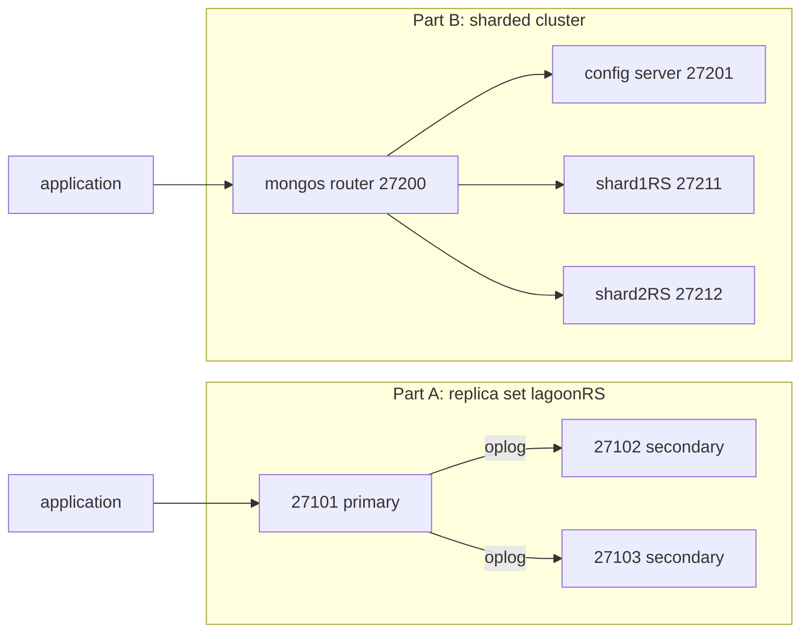

# Portfolio 5: Distributed and Cloud Database Exercise

**Student:** Ajilore Opeyemi (301930319)
**Case study:** LagoonPay (documents from Portfolio 4)
**Engine:** MongoDB 9.0 (`mongod`, `mongos`, `mongosh`)

## 1. Aim

Build two distributed deployments of the LagoonPay document database on one machine, break them on purpose, and record what happens. Then use those observations to propose how LagoonPay should be deployed in the cloud.

- **Part A, replication:** a three-member replica set. Tests cover write concern, stale reads from a lagging member, multi-document transactions, crash of the primary, and loss of the majority.
- **Part B, sharding:** a cluster with a config server, two shards and a router. Tests cover data distribution, targeted and scatter-gather queries, and the effect of a poor shard key.

All processes run on `127.0.0.1` on separate ports, so this is a simulation of a distributed system and not a deployment across real machines. Network delay between members is close to zero here, which matters when reading the timings.

## 2. Topology



In production every shard and the config server would each be a three-member replica set like Part A. Single members are used in Part B to keep the demonstration within a laptop's memory.

## 3. Results

Run on my MacBook Pro with MongoDB 9.0.8. Full output is in `results/`.

### Part A: replica set

| Test | What was done | Result on my machine |
|---|---|---|
| A2 | 2,000 customers loaded with `w: 3` | 2,000 documents counted on each of the three members |
| A3 | 200 writes at each write concern | `w: 1` 0.47 ms; `w: 3` 0.88 ms; `w: "majority"` 10.29 ms; `w: "majority", j: true` 10.93 ms per write |
| A4 | One secondary paused, then a 5,000 deposit with `w: "majority"` | Confirmed by the primary and the healthy secondary; the paused secondary still returned the old balance (stale read) |
| A4 | Same deposit with `w: 3` while one member is paused | Not confirmed: `waiting for replication timed out` |
| A5 | Report with read preference `secondary` | Served by 127.0.0.1:27102, a secondary, while 27101 was primary |
| T1 | Transfer across two customer documents in one transaction | COMMITTED; both balances changed |
| T2 | Transfer where the debit breaks the balance rule | ABORTED; the credit already made in the transaction was undone |
| T3 | Read from another session during an open transaction | The uncommitted change was not visible (5,033,320.74 outside, 5,034,097.74 inside) |
| F1 | `kill -9` on the primary while a client writes every 0.5 s | New primary elected (27103). One write waited **10,212 ms**; typical write 16 ms. 60 of 60 writes acknowledged and 60 documents stored |
| F2 | Crashed member restarted | Rejoined as SECONDARY and caught up to 60 documents |
| F3 | Two of three members killed | Survivor stepped down to SECONDARY; write refused (`not primary`); read still answered. After restart, a primary was elected and writes were accepted again |

A note on A3. `w: "majority"` was slower than `w: 3`, although three members is more than a majority. The two settings do not wait for the same thing. With `w: "majority"` MongoDB also waits for the write to reach the on-disk journal on a majority of members, which is why adding `j: true` made no difference (10.29 ms against 10.93 ms). A plain `w: 3` waits only until all three members have applied the write in memory. So the roughly 10 ms is the price of a write that survives a power failure, not the price of the network, which on one machine is near zero.

The line `Killed: 9 ... mongod` in `results/04_failover.txt` is the shell reporting that the process it started was killed. It is the crash being simulated, not an error.

### Part B: sharded cluster

| Test | What was done | Result on my machine |
|---|---|---|
| S2 | `activity` sharded on hashed `accountId`, then 103,060 documents loaded through the router | Pre-split into one chunk per shard before any data arrived. Accounts: 1,489 on shard 1 and 1,518 on shard 2. Documents: 41,119 and 61,941 |
| S3 | Statement of account 7 (filter contains the shard key) | Routing `SINGLE_SHARD`; only shard 2 contacted. All 2,593 entries of account 7 are on shard 2 |
| S4 | ATM withdrawals in Osogbo (no shard key in the filter) | Routing `SHARD_MERGE`; both shards contacted |
| S5 | Second collection sharded on ranged `createdAt`, 30,000 documents loaded | One chunk; all 30,000 documents on shard 1, none on shard 2 |
| S6 | Unsharded `customers` collection | All 500 documents on shard 1, the database's primary shard |

In S2 the accounts are split almost exactly in half (49.5% and 50.5%) while the documents are split 40% and 60%. Hashing distributes shard key values evenly, and the values here are accounts. The merchant accounts created in Portfolio 2 each hold thousands of entries, and whichever shard receives more of them holds more documents.

## 4. Discussion

### 4.1 Replication and availability

A replica set keeps the same data on every member. One member is primary and takes all writes; the others copy its operation log. If the primary fails, the remaining members hold an election, and a member needs votes from a **majority** of the set to win.

Test F1 shows the cost of a crash: writes are unavailable for roughly the election timeout (10 seconds by default) while the survivors confirm the primary is gone and elect a replacement. No acknowledged write was lost, because each write had been confirmed by a majority before the client was told it succeeded, and the new primary is always chosen from members that have those writes. The application's part is to retry, and to make the retry safe: the writer uses a fixed `_id` per payment so a repeated attempt cannot store the payment twice (idempotency).

Test F3 shows the limit. With two of three members gone, the survivor cannot reach a majority, so it steps down and refuses writes. This is deliberate. If a minority could keep accepting writes, a network split could leave two primaries taking different transfers on the same account (split brain).

### 4.2 Consistency, and the CAP theorem

The CAP theorem says that when the network partitions, a distributed database must give up either consistency or availability. The tests show which way this deployment leans, and that the choice is made per operation:

| Setting | Behaviour seen | Leaning |
|---|---|---|
| Write with `w: "majority"` | Survives one failure (A4); refused when the majority is lost (F3) | Consistency over availability |
| Write with `w: 3` | Cannot be confirmed while one member lags (A4) | Strongest durability, weakest availability |
| Write with `w: 1` | Fastest (A3); a write could be lost if the primary dies before it is copied | Availability and speed over durability |
| Read from the primary | Always current | Consistent |
| Read from a secondary | Still answered when no primary exists (F3), but may be stale (A4) | Availability over consistency (eventual consistency) |

PACELC adds the everyday case: even with no failure, there is a trade between latency and consistency. A3 measures it directly as the extra time per write to wait for more members.

For LagoonPay the rule that follows is: anything that changes or displays a balance uses `w: "majority"` and reads from the primary. Reports and analytics may read from secondaries, where a few seconds of staleness is harmless and the load is kept off the primary (A5).

### 4.3 Transactions in a distributed setting

Portfolio 4 noted that a document validator protects only one document. On a replica set, MongoDB can wrap several documents in one ACID transaction. T1 to T3 repeat the Portfolio 3 tests in MongoDB: a transfer across two customer documents commits as a unit, a failed debit rolls back the credit that preceded it, and uncommitted changes are invisible to other sessions. Transactions hold locks and add round trips, and across shards they need two-phase commit, so the better design is still to keep data that changes together in one document, or to leave the ledger in PostgreSQL.

### 4.4 Sharding and choice of shard key

Replication copies all the data to every member, so it adds availability and read capacity but no write capacity. Sharding splits the data so that each shard holds part of it.

The shard key decides everything:

- **Hashed `accountId`** (S2 to S4). Accounts are spread almost evenly between the shards. All entries of one account stay together, so a statement, the most common query, is answered by a single shard (S3). The document counts are less even than the account counts because a few merchant accounts hold thousands of entries each, and one account can never be split across shards. That is the known weakness of this key: a very large account becomes a hot spot.
- **Queries without the shard key** (S4) are sent to every shard and merged by the router. They still work, but they do not get faster as shards are added.
- **Ranged `createdAt`** (S5). Every new entry has a later timestamp than the last, so all inserts go to the same end of the range and one shard takes all the writes. A time-based key suits range queries by date but removes the write scaling that sharding was meant to provide.

A stronger production key would be compound, `{ accountId: "hashed", createdAt: 1 }` or `{ accountId: 1, createdAt: 1 }`, which keeps statements on one shard while letting a huge account's history be divided by time.

### 4.5 Proposed cloud deployment for LagoonPay

| Layer | Choice | Reason, tied to the tests |
|---|---|---|
| Document store | Managed MongoDB service (for example MongoDB Atlas), three-member replica set, one member in each of three availability zones | Survives the loss of a zone with roughly ten seconds of write unavailability (F1); majority survives (F3 does not occur for a single-zone failure) |
| Sharding | Not at launch. Introduce when a single replica set cannot hold the activity feed, shard key on account then time | Scatter-gather cost (S4) and operational complexity are not worth paying early |
| Write and read settings | `w: "majority"`, primary reads for balances; secondary reads for reports | A3, A4, A5 |
| Disaster recovery | Continuous backup with point-in-time restore; optionally one extra member in a second region | Protects against operator error, which replication copies faithfully to every member |
| Ledger of record | Managed PostgreSQL (for example Amazon RDS or Cloud SQL) with a synchronous standby in a second zone and asynchronous read replicas | Same pattern as the replica set: synchronous standby is the `w: "majority"` case, read replicas are the secondary-read case |
| Large relational tables | Declarative partitioning of `transactions` and `ledger_entries` by month | The relational equivalent of range sharding, kept inside one server |
| Security | Private networking, TLS in transit, encryption at rest, least-privilege database users | Customer and financial data |
| Regulation | Primary region chosen to meet Nigerian data-residency requirements | Customer data location |

A managed service is preferred over self-managed virtual machines because the work shown in this portfolio (elections, restarting members, adding shards, backups) is then done by the provider, and a small bank's engineers can spend their time on the product.

## 5. How to run

Portfolio 4 must have been run first, because the documents in `../portfolio-4-nosql/data` are reused. From inside this folder:

```bash
sh run_all.sh
```

It takes about three minutes, starts and stops its own MongoDB processes on ports 27101 to 27212, and does not touch the normal MongoDB service on port 27017. Temporary data is written under `/tmp/lagoonpay-p5` and removed at the end. If a run is interrupted, `sh 07_stop_all.sh` cleans up.

| File | Purpose |
|---|---|
| `00_env.sh` | Ports, paths and helper functions |
| `01_replica_set_start.sh` | Starts three members and initiates the replica set |
| `02_replication.js` | Topology, load, write concern, lagging secondary, secondary reads |
| `03_transactions.js` | Multi-document transactions: commit, abort, isolation |
| `04_failover.sh`, `04_failover_writer.js` | Primary crash under load, rejoin, loss of majority |
| `05_sharded_cluster_start.sh` | Starts config server, two shards and the router |
| `06_sharding.js` | Adds shards, shards the collection, routing and distribution tests |
| `07_stop_all.sh` | Stops everything and removes temporary data |
| `run_all.sh` | Runs all of the above and writes output to `results/` |
